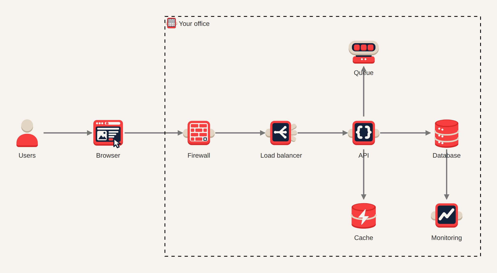

# Viaalink icons

An open icon set by [Viaalink](https://viaalink.com): **71 icons**, each as a **2.5D render made in Blender**
and a **flat SVG twin**, in a **light** and a **dark** edition. Plus the Blender pipeline that makes them,
flow diagrams with pipes between the icons, and story animations.


## Use the icons

| Folder | What |
|---|---|
| `icons/png/25d/{light,dark}` | 2.5D renders, 1024 px, transparent |
| `icons/png/flat/{light,dark}`, `icons/svg/{light,dark}` | flat twins |
| `icons/svg/themeable` | flat SVGs that follow CSS variables `--via-p --via-s --via-n --via-m --via-r --via-c` |
| `icons/svg/mono` | one colour (`currentColor`), for stamps, favicons and print |
| `icons/mermaid/viaalink.json` | Iconify set for Mermaid (`viaalink:<name>`, `viaalink:<name>-mono`) |
| `icons/drawio/*.xml` | draw.io / diagrams.net libraries (File → Open Library) |
| `icons/platform-marks/` | where Viaalink runs: GitHub, Apple, Android, Linux, Windows, Docker, Raspberry Pi, Bluetooth, Caddy. **Trademarks of their owners**, see [TRADEMARKS.md](TRADEMARKS.md) |

Mermaid (architecture diagrams with `viaalink:<name>`; one-colour stamps with `viaalink:<name>-mono`):



```js
mermaid.registerIconPacks([{ name: "viaalink", loader: () => fetch("/viaalink.json").then((r) => r.json()) }])
```

```text
architecture-beta
  group home(viaalink:nas)[Your office]
  service user(viaalink:user)[Users]
  service web(viaalink:browser)[Browser]
  service fw(viaalink:firewall)[Firewall] in home
  service lb(viaalink:loadbalancer)[Load balancer] in home
  service api(viaalink:api)[API] in home
  service db(viaalink:database)[Database] in home
  service cache(viaalink:cache)[Cache] in home
  service queue(viaalink:queue)[Queue] in home
  service mon(viaalink:monitoring)[Monitoring] in home
  user:R --> L:web
  web:R --> L:fw
  fw:R --> L:lb
  lb:R --> L:api
  api:R --> L:db
  api:B --> T:cache
  api:T --> B:queue
  db:B --> T:mon
```

(The code is shown as text: GitHub renders Mermaid itself but cannot load an icon pack, so the icons would
show as "?" there. Serve `icons/mermaid/viaalink.json` from your own site and register it as above.
Source: [docs/examples/mermaid-architecture.mmd](docs/examples/mermaid-architecture.mmd).)

Icons: `ai-a` · `api` · `backup` · `bell` · `browser-ext` · `browser` · `bucket` · `cache` · `calendar` · `call` · `certstore` · `chat` · `check` · `cicd` · `cli` · `cloud` · `cluster` · `config` · `container` · `database` · `desktop` · `dns` · `download` · `error` · `files` · `firewall` · `globe` · `info` · `key` · `license` · `link` · `loadbalancer` · `lock` · `logs` · `mail` · `mcp-a` · `meet` · `minutes` · `modem` · `monitoring` · `nas` · `notetaker` · `page` · `payment` · `pending` · `phone` · `qr-pair` · `queue` · `record` · `relay` · `report` · `router` · `search` · `server` · `shield` · `social` · `switch` · `sync` · `tablet` · `team` · `transcribe` · `trash` · `upload` · `user` · `video` · `vm` · `voice-profile` · `vscode` · `warning` · `webhook` · `wifi`

## Make them yourself

### System requirements

| | Minimum | Used to make this set |
|---|---|---|
| OS | Linux x64 (Ubuntu/Debian 24.04+); macOS and Windows via Docker | Ubuntu 24.04 |
| Blender | 4.2 LTS or newer, headless | 5.3 |
| Bun | 1.1+ | 1.4 |
| just, ffmpeg, zip | any recent | just 1.46, ffmpeg 6.1 |
| Fonts (render only, see [Brand](#brand)) | DejaVu Sans Bold, JetBrains Mono Bold (OFL) | |
| GPU | optional: NVIDIA (OptiX/CUDA). Without one Blender renders on the CPU: same result, slower | RTX 5070 Ti |
| Disk / RAM | ~2 GB for the tools, 8 GB RAM | |

### Setup

**Docker (any OS):**

```sh
docker build -t viaalink-icons .
docker run --rm -v "$PWD":/work --user "$(id -u):$(id -g)" -e HOME=/tmp viaalink-icons \
  just icons-blender local/icons/rounds/25d-b7 --samples 48 relay
# NVIDIA GPU: add --gpus all. The first run installs the Bun dependencies into the repo (node_modules).
```

**Linux, without Docker:** `scripts/setup-linux.sh` installs ffmpeg, just and the fonts via apt, Blender from
blender.org into `~/.local/opt`, Bun, and runs `bun install`.

**By hand:** install the tools in the table, put JetBrains Mono Bold in `~/.local/share/fonts` (or point
`VIA_ICON_FONT` at it), then `bun install`.

### Run

```sh
just icons-blender local/icons/rounds/25d-b7 --samples 48   # every 2.5D icon, light + dark (or name a few: ... relay lock)
just icons-flat local/icons/rounds/flat-r9                   # the flat twins
just icons-blender-gate                                      # no clipped white, both editions, nothing cropped
just icons-pack                                              # SVG/PNG/Mermaid/draw.io → local/icons/pack
just icons-diagram relay-ha                                  # a flow diagram (scripts/icons/blender/diagrams/relay-ha.json)
just icons-story relay-ha                                    # its story animation: nodes pop in, pipes draw, a Relay fails
just icons-gallery                                           # the gallery on http://127.0.0.1:5330 (needs the via CLI)
```

AI concept sketches (`just icons-render`) need an `OPENROUTER_API_KEY` in your environment. The rest runs
offline.


How the set was made, with AI agents as executor and art director: [docs/HOW-WE-MADE-IT.md](docs/HOW-WE-MADE-IT.md).
Which ideas, choices and rejections came from the human: [docs/HUMAN-DIRECTION.md](docs/HUMAN-DIRECTION.md).
The working rules the agents follow: [docs/skill/SKILL.md](docs/skill/SKILL.md); real task files: [docs/tasks](docs/tasks).

## Make it your brand

Everything that is brand or look lives in **one file**: [`theme/brand.json`](theme/brand.json) (checked against
[`theme/brand.schema.json`](theme/brand.schema.json)). The models in `build.py` only hold shapes; every script
reads the theme through one loader per language (`scripts/icons/theme.py`, `scripts/icons/theme.ts`).

| Theme key | What it sets |
|---|---|
| `brand` | name, `slug` (Iconify prefix, pack and zip names), `cssPrefix` (`--via-p` …), `cliWord` (the `> via` prompt) |
| `fonts`, `logo` | font files and logo SVGs (paths relative to the theme file) |
| `colors25d`, `materials` | 2.5D colours per role and mode, cream albedo, navy lift, glow, roughness |
| `flat` | flat role colours per mode (`p s n m r c`), the lip depth |
| `pages`, `gallery` | page colours behind sheets, films and the gallery |
| `camera`, `lights`, `render` | azimuth, pitch, framing margin; key and rim light; samples, exposure, world |
| `shape` | default bevels, smoothing, the device family's pipe port |
| `canvas`, `gate` | icon size, margin, optical size; the gate's thresholds |
| `diagram`, `animation`, `prompt` | pipes, grid, board, labels; film defaults; the AI concept palette |

To make the set for another brand:

1. Copy `theme/brand.json` somewhere of your own (keep `brand.schema.json` next to it if you want editor hints).
2. Change the colours, fonts, logo paths and `brand` names. Paths are relative to your copy.
3. Point the pipeline at it and render:

```sh
export VIA_ICON_THEME=$PWD/my-brand.json
just theme-check                                             # validates it (both loaders), names any missing key
just icons-blender local/icons/rounds/25d-b-mine --samples 48  # 2.5D (the gate checks rounds named 25d-b*)
just icons-flat local/icons/rounds/flat-mine                 # flat twins
just icons-blender-gate                                      # GATE: pass
just icons-pack --r25 local/icons/rounds/25d-b-mine --rflat local/icons/rounds/flat-mine  # packs under your slug
```

Icon names and shapes stay the same; the logo inside the Relay and the record phone comes from `logo`.

**Lint:** `just lint` (ruff for Python, Biome and `tsc` for TypeScript, plus the theme check) exits 1 on any
problem; `just fmt` fixes what can be fixed. **Refactors:** `just icons-check-dump`, `icons-check-svg` and
`icons-check-png` prove that flat SVGs stay byte-identical and renders stay within Cycles noise.

## Brand

Colours, typography (Space Grotesk, IBM Plex Mono) and logo use: **[viaalink.com/brand](https://viaalink.com/brand)**.
The icon palette follows it: Viaalink Red `#F73F3F`, navy, paper `#F6F3EE`. The fonts in the requirements table
are only what the renderer needs for the few letters inside icons (the `> via` prompt, the Docker containers).

## Licence

- Icons, renders, diagrams and docs: **CC BY 4.0** ([LICENSE-ICONS](LICENSE-ICONS)). Credit: "Icons by Viaalink, viaalink.com".
- Code (the pipeline under `scripts/`): **MIT** ([LICENSE](LICENSE)).
- The **Viaalink mark** (the logo inside some icons and in `static/assets`) and the **platform marks** are trademarks
  and are not covered by these licences: see [TRADEMARKS.md](TRADEMARKS.md).

Made in the Netherlands.
