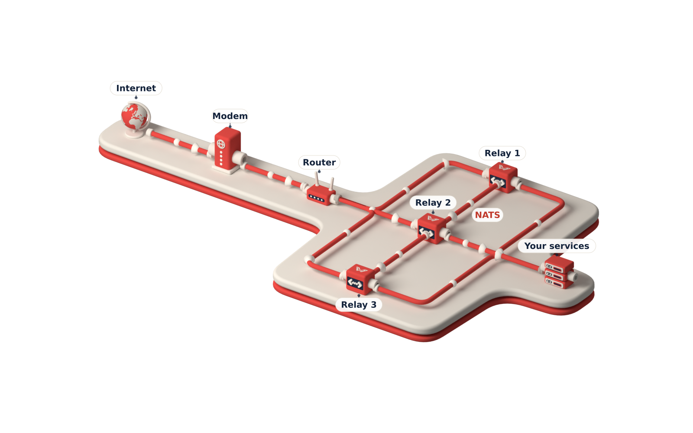

# Viaalink icons

An open icon set by [Viaalink](https://viaalink.com): **71 icons**, each as a **2.5D render made in Blender**
and a **flat SVG twin**, in a **light** and a **dark** edition. Plus the Blender pipeline that makes them,
flow diagrams with pipes between the icons, and story animations.



## Use the icons

| Folder | What |
|---|---|
| `icons/png/25d/{light,dark}` | 2.5D renders, 1024 px, transparent |
| `icons/png/flat/{light,dark}`, `icons/svg/{light,dark}` | flat twins |
| `icons/svg/themeable` | flat SVGs that follow CSS variables `--via-p --via-s --via-n --via-m --via-r --via-c` |
| `icons/svg/mono` | one colour (`currentColor`), for stamps, favicons and print |
| `icons/mermaid/viaalink.json` | Iconify set for Mermaid (`viaalink:<name>`, `viaalink:<name>-mono`) |
| `icons/drawio/*.xml` | draw.io / diagrams.net libraries (File → Open Library) |
| `icons/platform-marks/` | where Viaalink runs: GitHub, Apple, Android, Linux, Windows, Docker, Raspberry Pi, Bluetooth, Caddy. **Trademarks of their owners**, see [TRADEMARKS.md](TRADEMARKS.md) |

Mermaid:

```js
mermaid.registerIconPacks([{ name: "viaalink", loader: () => fetch("/viaalink.json").then((r) => r.json()) }])
```



```mermaid
architecture-beta
  service phone(viaalink:record)[Notetaker phone]
  service relay(viaalink:relay)[Your Relay]
  service ai(viaalink:ai-a)[Your AI]
  phone:R --> L:relay
  relay:R --> L:ai
```

Icons: `ai-a` · `api` · `backup` · `bell` · `browser-ext` · `browser` · `bucket` · `cache` · `calendar` · `call` · `certstore` · `chat` · `check` · `cicd` · `cli` · `cloud` · `cluster` · `config` · `container` · `database` · `desktop` · `dns` · `download` · `error` · `files` · `firewall` · `globe` · `info` · `key` · `license` · `link` · `loadbalancer` · `lock` · `logs` · `mail` · `mcp-a` · `meet` · `minutes` · `modem` · `monitoring` · `nas` · `notetaker` · `page` · `payment` · `pending` · `phone` · `qr-pair` · `queue` · `record` · `relay` · `report` · `router` · `search` · `server` · `shield` · `social` · `switch` · `sync` · `tablet` · `team` · `transcribe` · `trash` · `upload` · `user` · `video` · `vm` · `voice-profile` · `vscode` · `warning` · `webhook` · `wifi`

## Make them yourself

Requirements: [Blender](https://www.blender.org) 4.x or 5.x, [Bun](https://bun.sh), [just](https://just.systems), ffmpeg,
and the fonts DejaVu Sans Bold and JetBrains Mono Bold (`VIA_ICON_FONT` points to the latter if it is not in
`~/.local/share/fonts`).

```sh
bun install
just icons-blender local/icons/rounds/25d-b7 --samples 48   # every 2.5D icon, light + dark (or name a few: ... relay lock)
just icons-flat local/icons/rounds/flat-r9                   # the flat twins
just icons-blender-gate                                      # no clipped white, both editions, nothing cropped
just icons-pack                                              # SVG/PNG/Mermaid/draw.io → local/icons/pack
just icons-diagram relay-ha                                  # a flow diagram (scripts/icons/blender/diagrams/relay-ha.json)
just icons-story relay-ha                                    # its story animation: nodes pop in, pipes draw, a Relay fails
```


How the set was made, with AI agents as executor and art director: [docs/HOW-WE-MADE-IT.md](docs/HOW-WE-MADE-IT.md).
The working rules the agents follow: [docs/skill/SKILL.md](docs/skill/SKILL.md); real task files: [docs/tasks](docs/tasks).

## Licence

- Icons, renders, diagrams and docs: **CC BY 4.0** ([LICENSE-ICONS](LICENSE-ICONS)). Credit: "Icons by Viaalink, viaalink.com".
- Code (the pipeline under `scripts/`): **MIT** ([LICENSE](LICENSE)).
- The **Viaalink mark** (the logo inside some icons and in `static/assets`) and the **platform marks** are trademarks
  and are not covered by these licences: see [TRADEMARKS.md](TRADEMARKS.md).

Made in the Netherlands.
