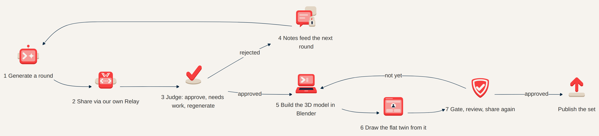

# How we made the Viaalink icons

## 0. Where it started

The icon generator behind this set was designed last year by Kelvin Wuite at ASD Engineering, for the icons of
the ASD Manager. It generated icons with OpenAI's image API, until OpenAI blocked his access. He then ported the
code to OpenRouter (`scripts/icons/openrouter.ts`, `render.ts`, `style.ts`, `catalog.ts`), so it no longer
depends on a single provider.

In November 2026 that code became the starting point for Viaalink's own set. Kelvin set the direction and
approved every icon. AI agents did the work with him: one as product owner and QA, one building in Blender,
and independent reviewers who judged the results by looking at them. What came from Kelvin, decision by
decision, is in [HUMAN-DIRECTION.md](HUMAN-DIRECTION.md).

## 1. From AI pictures to Blender

The first Viaalink rounds came straight from that generator (via OpenRouter). The icons looked good one by
one, but never matched each other: every icon had its own light, camera and red. So the 2.5D set moved to
**Blender**, where every icon shares one camera, one light rig and one palette:

- `scripts/icons/blender/build.py` models each icon from simple parts (rounded boxes, curves, extruded SVG
  paths) with a role per part: body red, cream secondary, navy only in recesses, glowing details.
- Light and dark are the same model with a palette swap, so they never drift apart.
- Colours, fonts, logo, camera, light rig and materials sit in one theme file (`theme/brand.json`), so the
  same pipeline can make the set for another brand.
- `scripts/icons/flat.ts` draws the flat twin of each icon as SVG on a 24-unit grid, part by part, with a
  "lip" (the same shape shifted down in a darker shade) as its only depth cue.

The generator is still used, but only for **concepts**. When a new icon is needed, we write three to five
ideas in text, render rough AI sketches with the existing Blender icons attached as style references, a human
picks one, and it is then built in Blender. The Caddy, Let's Encrypt, DNS and IT-diagram icons were made this
way.

## 1b. The loop: from shared images to 3D, and from 3D to flat

Every round of images goes through the same loop, which Kelvin designed:

1. **Generate** a round of candidates (`just icons-render`).
2. **Share** it: `just review-round open <name>` snapshots the renders into a feedback round and starts the
   gallery (`tools/icon-gallery`) on Viaalink's own machine, published through Viaalink's own Relay.
   `just review-share` prints a random link with basic auth in it, so colleagues, testers and outside
   reviewers can look. Each new round gets a new link and password.
3. **Judge**: on `/approve` reviewers give each image a thumbs up, or a thumbs down with a comment, discuss in a
   thread and request missing icons. A human approves: only the owner sets a verdict (approved, needs work,
   rejected or regenerate, with a note), and the server checks that.
4. **Feed back**: `just review-round close <name> --feed` writes `local/icons/feedback/<name>.json` and `.md`,
   and `just icons-regen <out> local/icons/feedback/<name>.json` renders the regenerate and needs-work images
   again with the notes and comments in the prompt, so a rejection becomes the brief for the next attempt.
   A round closed with `--no-feed` stays a closed circle: its feedback is kept, but never fed.
5. **Build in 3D**: an approved image is the target for a Blender model (`build.py`).
6. **Back to 2D**: from that 3D object the flat twin is drawn as code (`flat.ts`): the same parts, the same
   colour roles (cream becomes sand, navy and red stay accents), checked side by side on one contact sheet.
7. **Judge again**: the colour gate, a look at every render, an independent review, and the shared gallery.



(Drawn in Mermaid with this set's own icons: [examples/loop.mmd](examples/loop.mmd).)

Drawing the loop with the set was also a test of the set, and it showed gaps for 0.2: there is no icon for
a **3D model** (Blender) or for **drawing a vector**, so the laptop and the page stand in; **voting** and
**review** have no icon of their own (a check mark stands in); and the flowchart's icon nodes draw the
icons lighter than the architecture diagrams do, which needs a look.

**Reproducible.** Both the 3D model and the flat twin are code, so the same commands rebuild every icon
exactly, in light and dark. The step from 3D to flat is a design step today: the twin is drawn from the
model, not computed from it. Computing it (an orthographic front render turned into SVG paths per colour
role) is a possible next step.

## 2. Agents with a gate, not a promise

The Blender work was done by an executor agent (Google's Antigravity CLI, `agy`) from short task files. Real
ones are in [docs/tasks](tasks). Every task ends the same way:

```
just icons-blender ... ; just icons-flat ... ; just icons-blender-gate   # must print GATE: pass
```

The agent iterates at most three times per icon and reports "done" or "NOT DONE: why" per icon. The
reviewing agent never trusts the report. It renders a contact sheet (2.5D and flat, light and dark, side by
side), **looks at it**, and only then commits. The working rules the agents follow are in
[docs/skill/SKILL.md](skill/SKILL.md).

## 3. Rules that came from looking

Most of the house style came from looking at renders and saying what was wrong:

- **The icon is the object.** No tile or disc behind an icon. A Wi-Fi icon is the arcs themselves, and a
  sync icon is the two arrows (the reference icon).
- **One family for infrastructure.** Relay, modem, router, server, NAS, Caddy, certificate store and DNS
  keep their own shapes, but share the same cream pipe ports, so pipes plug into them in diagrams.
- **2D matches 2.5D.** The flat twins use sand where the 2.5D uses cream. Navy and red are accents.
- **Colour is checked on screen.** The red is measured, not guessed, because a monitor's night mode once
  made it look orange.

## 4. Independent review

Before the release, a reviewer agent that had not seen the work scored every icon from contact sheets
alone: 2.5D 7.2/10, flat 7.2/10. It named the weakest icons (a backup that read as a cooking pot, three
near-identical phone icons, a navy penguin that vanished on dark), and those were redone. Its list of
missing icons is the plan for 0.2.

## 5. From icons to diagrams and films

`diagram.py` places icons on a board shaped to the diagram and routes pipes between them. Labels are
projected from 3D, so they can be drawn as crisp HTML over a video. `story.py` turns a diagram into a short
story: nodes pop in, pipes draw themselves, packets flow, and a node can fail while the rest keeps serving.
Viaalink's promotional films are built from these clips.
