# Viaalink icons

72 icons, each as a 2.5D render (Blender) and a flat twin, in a light and a dark edition.

| Folder | What |
|---|---|
| `png/25d/{light,dark}` | 2.5D renders, 1024 px, transparent |
| `png/flat/{light,dark}`, `svg/{light,dark}` | flat twins |
| `svg/themeable` | flat twins that follow CSS variables `--via-p --via-s --via-n --via-m --via-r --via-c` (light colours as fallback) |
| `svg/mono` | one colour (`currentColor`), for stamps, favicons and print |
| `mermaid/viaalink.json` | Iconify set for Mermaid |
| `drawio/*.xml` | draw.io / diagrams.net libraries (File → Open Library); draw.io exports Visio (.vsdx) |

## Mermaid

```js
mermaid.registerIconPacks([{ name: "viaalink", loader: () => fetch("/viaalink.json").then((r) => r.json()) }])
```

```mermaid
architecture-beta
  service phone(viaalink:record)[Notetaker phone]
  service relay(viaalink:relay)[Your Relay]
  service ai(viaalink:ai-a)[Your AI]
  phone:R --> L:relay
  relay:R --> L:ai
```



Use `viaalink:<name>-mono` for the one-colour version.

## Icons

`ai-a` · `api` · `backup` · `bell` · `browser` · `browser-ext` · `bucket` · `cache` · `calendar` · `call` · `certstore` · `chat` · `check` · `cicd` · `cli` · `cloud` · `cluster` · `config` · `container` · `database` · `desktop` · `dns` · `download` · `error` · `files` · `firewall` · `globe` · `info` · `key` · `laptop` · `license` · `link` · `loadbalancer` · `lock` · `logs` · `mail` · `mcp-a` · `meet` · `minutes` · `modem` · `monitoring` · `nas` · `notetaker` · `page` · `payment` · `pending` · `phone` · `qr-pair` · `queue` · `record` · `relay` · `report` · `router` · `search` · `server` · `shield` · `social` · `switch` · `sync` · `tablet` · `team` · `transcribe` · `trash` · `upload` · `user` · `video` · `vm` · `voice-profile` · `vscode` · `warning` · `webhook` · `wifi`

Platform marks (GitHub, Apple, Windows, Linux, Android, Docker, Raspberry Pi) are trademarks of their owners; use them only to say where Viaalink runs.
